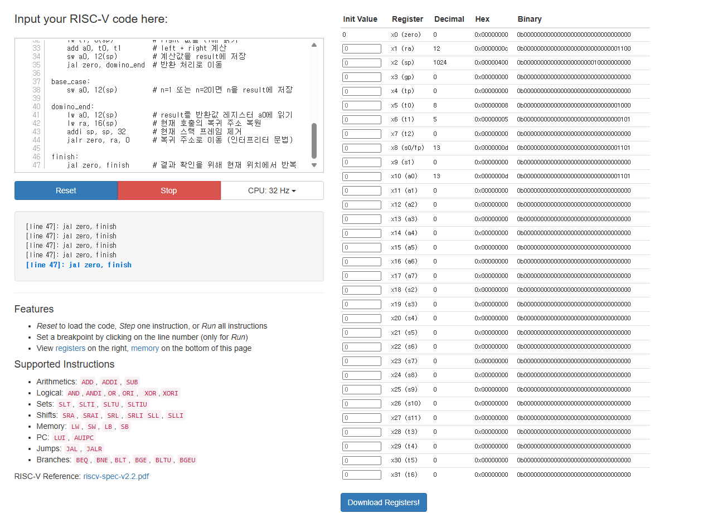

# 1.
## c언어
```


#include <stdio.h>   // printf() 등 표준 입출력 함수 사용
#include <stdlib.h>  // malloc(), free(), exit() 함수 사용

// 스택에 저장할 수 있는 최대 프레임 개수
#define MAX_STACK 100

/*
 * StackFrame 구조체
 *
 * domino() 함수가 호출될 때마다 생성되는
 * 하나의 논리적 스택 프레임을 나타낸다.
 *
 * 각 프레임에는 함수 실행에 필요한 매개변수와
 * 재귀 호출의 결과 및 최종 반환값을 저장한다.
 */
typedef struct {
    int n;       // 현재 domino() 함수에 전달된 매개변수
    int left;    // domino(n-1)의 반환값을 저장
    int right;   // domino(n-2)의 반환값을 저장
    int result;  // 현재 domino(n)의 최종 계산 결과
} StackFrame;

/*
 * 전역 정수형 포인터 배열
 *
 * 각 원소에는 동적으로 생성한 StackFrame의 주소를 저장한다.
 * 실제 프레임의 메모리는 malloc()으로 힙 영역에 할당된다.
 *
 * stack[0] : 첫 번째 프레임의 주소
 * stack[1] : 두 번째 프레임의 주소
 * ...
 *
 * 주의:
 * 이 배열은 실제 C 프로그램의 호출 스택이 아니라
 * 재귀 함수의 실행 과정을 관찰하기 위한 별도의 스택이다.
 */
int *stack[MAX_STACK];

/*
 * top : 현재 스택의 최상단 인덱스
 *
 * -1 : 스택이 비어 있는 상태
 *  0 : 프레임이 1개 저장된 상태
 *  1 : 프레임이 2개 저장된 상태
 *
 * PUSH가 발생하면 top이 1 증가하고,
 * POP이 발생하면 top이 1 감소한다.
 */
int top = -1;

/*
 * printStack()
 *
 * 현재 스택에 저장된 모든 프레임의 정보를 출력한다.
 *
 * 스택의 최상단(top)부터 아래 방향으로 출력하여
 * 재귀 호출에 따라 쌓인 프레임을 확인할 수 있다.
 */
void printStack(void) {
    printf("\n========== STACK ==========\n");

    // top이 -1이면 저장된 프레임이 없는 상태
    if (top == -1) {
        printf("Stack is empty.\n");
    } else {

        // top부터 0번 인덱스까지 역순으로 탐색
        for (int i = top; i >= 0; i--) {

            /*
             * stack[i]는 int* 자료형이므로
             * 원래의 StackFrame* 자료형으로 변환한다.
             *
             * 이를 통해 구조체 내부의 멤버에 접근할 수 있다.
             */
            StackFrame *frame = (StackFrame *)stack[i];

            // 현재 프레임의 매개변수와 계산 결과 출력
            printf("Stack[%d] : n=%d, left=%d, right=%d, result=%d",
                   i, frame->n, frame->left,
                   frame->right, frame->result);

            // 현재 위치가 최상단이면 TOP 표시
            if (i == top) {
                printf("  <-- TOP");
            }

            printf("\n");
        }
    }

    printf("===========================\n");
}

/*
 * push(int n)
 *
 * 새로운 StackFrame을 생성하여 스택에 추가한다.
 *
 * 동작 과정
 * 1. 스택에 빈 공간이 있는지 확인
 * 2. malloc()으로 프레임 메모리 할당
 * 3. 구조체 멤버 초기화
 * 4. top 증가 후 프레임 주소 저장
 * 5. 현재 스택 상태 출력
 *
 * 반환값:
 * 새로 생성한 StackFrame의 주소
 */
StackFrame *push(int n) {

    /*
     * 스택 오버플로 검사
     *
     * 배열의 마지막 인덱스는 MAX_STACK-1이다.
     * top이 마지막 인덱스에 도달했다면
     * 새로운 프레임을 추가할 수 없다.
     */
    if (top >= MAX_STACK - 1) {
        printf("Stack Overflow!\n");
        exit(EXIT_FAILURE);
    }

    /*
     * malloc()으로 구조체 크기만큼 메모리 할당
     *
     * sizeof(StackFrame)은 구조체 전체 크기를 의미한다.
     * 반환된 주소는 frame에 저장된다.
     */
    StackFrame *frame = malloc(sizeof(StackFrame));

    // 메모리 할당 실패 시 프로그램 종료
    if (frame == NULL) {
        printf("Memory allocation failed!\n");
        exit(EXIT_FAILURE);
    }

    /*
     * 새로운 프레임의 멤버 초기화
     *
     * n에는 현재 함수의 매개변수를 저장한다.
     * 아직 계산하지 않은 값은 -1로 초기화하여
     * 계산이 완료되지 않았음을 나타낸다.
     */
    frame->n = n;
    frame->left = -1;
    frame->right = -1;
    frame->result = -1;

    /*
     * ++top : top을 먼저 1 증가
     * stack[top] : 증가된 위치에 프레임 주소 저장
     *
     * StackFrame*을 int*로 형변환하여 저장한다.
     *
     * 예시:
     * top = -1 -> 0
     * stack[0] = frame의 주소
     */
    stack[++top] = (int *)frame;

    // 새로운 재귀 호출 및 PUSH 발생 출력
    printf("\n[PUSH] domino(%d) called\n", n);

    // 프레임 추가 후 전체 스택 상태 확인
    printStack();

    // 생성된 프레임의 주소를 호출한 함수에 반환
    return frame;
}

/*
 * pop()
 *
 * 스택 최상단에 저장된 프레임을 제거한다.
 *
 * 스택은 LIFO(Last In First Out) 구조이므로
 * 가장 마지막에 추가한 프레임을 먼저 제거한다.
 *
 * 동작 과정
 * 1. 스택이 비어 있는지 확인
 * 2. 최상단 프레임의 주소 가져오기
 * 3. 프레임의 최종 계산 결과 출력
 * 4. free()로 동적 메모리 해제
 * 5. 배열 원소를 NULL로 설정
 * 6. top 감소
 * 7. 변경된 스택 상태 출력
 */
void pop(void) {

    // 스택이 비어 있는데 제거를 시도하는 경우
    if (top < 0) {
        printf("Stack Underflow!\n");
        exit(EXIT_FAILURE);
    }

    // 현재 최상단 프레임의 주소 가져오기
    StackFrame *frame = (StackFrame *)stack[top];

    // 제거할 프레임의 매개변수와 최종 결과 출력
    printf("\n[POP] domino(%d) finished, result=%d\n",
           frame->n, frame->result);

    /*
     * malloc()으로 할당한 메모리를 해제한다.
     *
     * 메모리 누수를 방지하기 위해
     * 프레임을 제거할 때 반드시 free()를 호출한다.
     */
    free(frame);

    // 해제된 메모리의 주소를 더 이상 참조하지 않도록 설정
    stack[top] = NULL;

    // 최상단 인덱스를 1 감소시켜 프레임 제거 반영
    top--;

    // POP 이후 남아 있는 프레임 출력
    printStack();
}

/*
 * domino(int n)
 *
 * 2 x n 크기의 직사각형을
 * 2 x 1 도미노로 채우는 경우의 수를 계산한다.
 *
 * 점화식:
 * domino(n) = domino(n-1) + domino(n-2)
 *
 * 종료 조건:
 * domino(1) = 1
 * domino(2) = 2
 *
 * 예시:
 * domino(3) = 2 + 1 = 3
 * domino(4) = 3 + 2 = 5
 * domino(5) = 5 + 3 = 8
 * domino(6) = 8 + 5 = 13
 *
 * 재귀 호출이 발생할 때마다 PUSH,
 * 함수가 종료될 때마다 POP을 수행한다.
 */
int domino(int n) {

    /*
     * 함수가 호출되면 새로운 프레임 생성
     *
     * 예시:
     * domino(6) 호출 -> PUSH(6)
     * domino(5) 호출 -> PUSH(5)
     * domino(4) 호출 -> PUSH(4)
     *
     * 각 호출은 서로 독립된 프레임을 가진다.
     */
    StackFrame *frame = push(n);

    // 현재 함수에서 계산한 결과를 저장할 지역변수
    int result;

    /*
     * 재귀 종료 조건(Base Case)
     *
     * n이 1 또는 2라면 추가 재귀 호출 없이
     * 바로 결과를 계산할 수 있다.
     *
     * domino(1) = 1
     * domino(2) = 2
     */
    if (n == 1 || n == 2) {
        result = n;
    } else {

        /*
         * 첫 번째 재귀 호출
         *
         * domino(n-1)을 먼저 실행한다.
         *
         * 호출된 함수가 종료되어 값을 반환할 때까지
         * 현재 함수는 다음 명령을 진행하지 않는다.
         *
         * 예시:
         * domino(6) -> domino(5)
         * domino(5) -> domino(4)
         * domino(4) -> domino(3)
         */
        int left = domino(n - 1);

        // 첫 번째 재귀 호출의 반환값을 프레임에 저장
        frame->left = left;

        /*
         * 두 번째 재귀 호출
         *
         * 첫 번째 재귀 호출이 완전히 끝난 후
         * domino(n-2)를 실행한다.
         *
         * 예시:
         * domino(6)의 두 번째 호출은 domino(4)이다.
         */
        int right = domino(n - 2);

        // 두 번째 재귀 호출의 반환값 저장
        frame->right = right;

        /*
         * 두 재귀 호출의 결과를 합산한다.
         *
         * 예시:
         * domino(6)
         * left  = domino(5) = 8
         * right = domino(4) = 5
         * result = 8 + 5 = 13
         */
        result = left + right;
    }

    /*
     * 현재 함수의 최종 결과를 프레임에 저장
     *
     * 이를 통해 POP 이전에 결과를 확인할 수 있다.
     */
    frame->result = result;

    // 현재 함수의 반환값 출력
    printf("\n[RETURN] domino(%d) = %d\n", n, result);

    /*
     * 프레임을 제거하기 전 스택 전체 출력
     *
     * 현재 함수의 n, left, right, result 값과
     * 아직 종료되지 않은 상위 함수들의 정보를 확인한다.
     */
    printStack();

    /*
     * 현재 함수의 계산이 완료되었으므로 POP 수행
     *
     * 프레임이 제거되면서 top이 감소한다.
     * 상위 재귀 함수의 프레임은 그대로 남아 있다.
     *
     * 주의:
     * pop() 이후 frame이 가리키던 메모리는 해제되므로
     * frame의 멤버에 다시 접근하면 안 된다.
     */
    pop();

    /*
     * 최종 계산 결과 반환
     *
     * 결과는 지역변수 result에 저장되어 있으므로
     * 프레임 메모리를 해제한 후에도 반환할 수 있다.
     */
    return result;
}

/*
 * main()
 *
 * 프로그램의 시작점
 *
 * domino(6)을 호출하고,
 * 최종 계산 결과와 스택이 비워졌는지 확인한다.
 */
int main(void) {

    // 계산할 도미노 직사각형의 길이
    int n = 6;

    // 프로그램 시작 메시지 출력
    printf("Domino Recursion Simulation\n");
    printf("n = %d\n", n);

    /*
     * domino(6) 실행
     *
     * 재귀 호출 과정에서 각 프레임의
     * PUSH, RETURN, POP 상태가 순서대로 출력된다.
     *
     * 모든 재귀 호출이 완료되면
     * 최종 결과 13이 answer에 저장된다.
     */
    int answer = domino(n);

    // 최종 계산 결과 출력
    printf("\n===========================\n");
    printf("Final Result : %d\n", answer);

    /*
     * 최종 스택 상태 확인
     *
     * 모든 함수 호출에서 POP이 정상적으로 수행되었다면
     * top은 초기 상태인 -1로 돌아온다.
     *
     * 즉, 시뮬레이션 스택의 모든 프레임이 제거된 것이다.
     */
    printf("Final Stack Top : %d\n", top);
    printf("===========================\n");

    // 프로그램 정상 종료
    return 0;
}

```
## 실행결과 및 스택 변화
```
Domino Recursion Simulation
n = 6

[PUSH] domino(6) called

========== STACK ==========
Stack[0] : n=6, left=-1, right=-1, result=-1  <-- TOP
===========================

[PUSH] domino(5) called

========== STACK ==========
Stack[1] : n=5, left=-1, right=-1, result=-1  <-- TOP
Stack[0] : n=6, left=-1, right=-1, result=-1
===========================

[PUSH] domino(4) called

========== STACK ==========
Stack[2] : n=4, left=-1, right=-1, result=-1  <-- TOP
Stack[1] : n=5, left=-1, right=-1, result=-1
Stack[0] : n=6, left=-1, right=-1, result=-1
===========================

[PUSH] domino(3) called

========== STACK ==========
Stack[3] : n=3, left=-1, right=-1, result=-1  <-- TOP
Stack[2] : n=4, left=-1, right=-1, result=-1
Stack[1] : n=5, left=-1, right=-1, result=-1
Stack[0] : n=6, left=-1, right=-1, result=-1
===========================

[PUSH] domino(2) called

========== STACK ==========
Stack[4] : n=2, left=-1, right=-1, result=-1  <-- TOP
Stack[3] : n=3, left=-1, right=-1, result=-1
Stack[2] : n=4, left=-1, right=-1, result=-1
Stack[1] : n=5, left=-1, right=-1, result=-1
Stack[0] : n=6, left=-1, right=-1, result=-1
===========================

[RETURN] domino(2) = 2

========== STACK ==========
Stack[4] : n=2, left=-1, right=-1, result=2  <-- TOP
Stack[3] : n=3, left=-1, right=-1, result=-1
Stack[2] : n=4, left=-1, right=-1, result=-1
Stack[1] : n=5, left=-1, right=-1, result=-1
Stack[0] : n=6, left=-1, right=-1, result=-1
===========================

[POP] domino(2) finished, result=2

========== STACK ==========
Stack[3] : n=3, left=-1, right=-1, result=-1  <-- TOP
Stack[2] : n=4, left=-1, right=-1, result=-1
Stack[1] : n=5, left=-1, right=-1, result=-1
Stack[0] : n=6, left=-1, right=-1, result=-1
===========================

[PUSH] domino(1) called

========== STACK ==========
Stack[4] : n=1, left=-1, right=-1, result=-1  <-- TOP
Stack[3] : n=3, left=2, right=-1, result=-1
Stack[2] : n=4, left=-1, right=-1, result=-1
Stack[1] : n=5, left=-1, right=-1, result=-1
Stack[0] : n=6, left=-1, right=-1, result=-1
===========================

[RETURN] domino(1) = 1

========== STACK ==========
Stack[4] : n=1, left=-1, right=-1, result=1  <-- TOP
Stack[3] : n=3, left=2, right=-1, result=-1
Stack[2] : n=4, left=-1, right=-1, result=-1
Stack[1] : n=5, left=-1, right=-1, result=-1
Stack[0] : n=6, left=-1, right=-1, result=-1
===========================

[POP] domino(1) finished, result=1

========== STACK ==========
Stack[3] : n=3, left=2, right=-1, result=-1  <-- TOP
Stack[2] : n=4, left=-1, right=-1, result=-1
Stack[1] : n=5, left=-1, right=-1, result=-1
Stack[0] : n=6, left=-1, right=-1, result=-1
===========================

[RETURN] domino(3) = 3

========== STACK ==========
Stack[3] : n=3, left=2, right=1, result=3  <-- TOP
Stack[2] : n=4, left=-1, right=-1, result=-1
Stack[1] : n=5, left=-1, right=-1, result=-1
Stack[0] : n=6, left=-1, right=-1, result=-1
===========================

[POP] domino(3) finished, result=3

========== STACK ==========
Stack[2] : n=4, left=-1, right=-1, result=-1  <-- TOP
Stack[1] : n=5, left=-1, right=-1, result=-1
Stack[0] : n=6, left=-1, right=-1, result=-1
===========================

[PUSH] domino(2) called

========== STACK ==========
Stack[3] : n=2, left=-1, right=-1, result=-1  <-- TOP
Stack[2] : n=4, left=3, right=-1, result=-1
Stack[1] : n=5, left=-1, right=-1, result=-1
Stack[0] : n=6, left=-1, right=-1, result=-1
===========================

[RETURN] domino(2) = 2

========== STACK ==========
Stack[3] : n=2, left=-1, right=-1, result=2  <-- TOP
Stack[2] : n=4, left=3, right=-1, result=-1
Stack[1] : n=5, left=-1, right=-1, result=-1
Stack[0] : n=6, left=-1, right=-1, result=-1
===========================

[POP] domino(2) finished, result=2

========== STACK ==========
Stack[2] : n=4, left=3, right=-1, result=-1  <-- TOP
Stack[1] : n=5, left=-1, right=-1, result=-1
Stack[0] : n=6, left=-1, right=-1, result=-1
===========================

[RETURN] domino(4) = 5

========== STACK ==========
Stack[2] : n=4, left=3, right=2, result=5  <-- TOP
Stack[1] : n=5, left=-1, right=-1, result=-1
Stack[0] : n=6, left=-1, right=-1, result=-1
===========================

[POP] domino(4) finished, result=5

========== STACK ==========
Stack[1] : n=5, left=-1, right=-1, result=-1  <-- TOP
Stack[0] : n=6, left=-1, right=-1, result=-1
===========================

[PUSH] domino(3) called

========== STACK ==========
Stack[2] : n=3, left=-1, right=-1, result=-1  <-- TOP
Stack[1] : n=5, left=5, right=-1, result=-1
Stack[0] : n=6, left=-1, right=-1, result=-1
===========================

[PUSH] domino(2) called

========== STACK ==========
Stack[3] : n=2, left=-1, right=-1, result=-1  <-- TOP
Stack[2] : n=3, left=-1, right=-1, result=-1
Stack[1] : n=5, left=5, right=-1, result=-1
Stack[0] : n=6, left=-1, right=-1, result=-1
===========================

[RETURN] domino(2) = 2

========== STACK ==========
Stack[3] : n=2, left=-1, right=-1, result=2  <-- TOP
Stack[2] : n=3, left=-1, right=-1, result=-1
Stack[1] : n=5, left=5, right=-1, result=-1
Stack[0] : n=6, left=-1, right=-1, result=-1
===========================

[POP] domino(2) finished, result=2

========== STACK ==========
Stack[2] : n=3, left=-1, right=-1, result=-1  <-- TOP
Stack[1] : n=5, left=5, right=-1, result=-1
Stack[0] : n=6, left=-1, right=-1, result=-1
===========================

[PUSH] domino(1) called

========== STACK ==========
Stack[3] : n=1, left=-1, right=-1, result=-1  <-- TOP
Stack[2] : n=3, left=2, right=-1, result=-1
Stack[1] : n=5, left=5, right=-1, result=-1
Stack[0] : n=6, left=-1, right=-1, result=-1
===========================

[RETURN] domino(1) = 1

========== STACK ==========
Stack[3] : n=1, left=-1, right=-1, result=1  <-- TOP
Stack[2] : n=3, left=2, right=-1, result=-1
Stack[1] : n=5, left=5, right=-1, result=-1
Stack[0] : n=6, left=-1, right=-1, result=-1
===========================

[POP] domino(1) finished, result=1

========== STACK ==========
Stack[2] : n=3, left=2, right=-1, result=-1  <-- TOP
Stack[1] : n=5, left=5, right=-1, result=-1
Stack[0] : n=6, left=-1, right=-1, result=-1
===========================

[RETURN] domino(3) = 3

========== STACK ==========
Stack[2] : n=3, left=2, right=1, result=3  <-- TOP
Stack[1] : n=5, left=5, right=-1, result=-1
Stack[0] : n=6, left=-1, right=-1, result=-1
===========================

[POP] domino(3) finished, result=3

========== STACK ==========
Stack[1] : n=5, left=5, right=-1, result=-1  <-- TOP
Stack[0] : n=6, left=-1, right=-1, result=-1
===========================

[RETURN] domino(5) = 8

========== STACK ==========
Stack[1] : n=5, left=5, right=3, result=8  <-- TOP
Stack[0] : n=6, left=-1, right=-1, result=-1
===========================

[POP] domino(5) finished, result=8

========== STACK ==========
Stack[0] : n=6, left=-1, right=-1, result=-1  <-- TOP
===========================

[PUSH] domino(4) called

========== STACK ==========
Stack[1] : n=4, left=-1, right=-1, result=-1  <-- TOP
Stack[0] : n=6, left=8, right=-1, result=-1
===========================

[PUSH] domino(3) called

========== STACK ==========
Stack[2] : n=3, left=-1, right=-1, result=-1  <-- TOP
Stack[1] : n=4, left=-1, right=-1, result=-1
Stack[0] : n=6, left=8, right=-1, result=-1
===========================

[PUSH] domino(2) called

========== STACK ==========
Stack[3] : n=2, left=-1, right=-1, result=-1  <-- TOP
Stack[2] : n=3, left=-1, right=-1, result=-1
Stack[1] : n=4, left=-1, right=-1, result=-1
Stack[0] : n=6, left=8, right=-1, result=-1
===========================

[RETURN] domino(2) = 2

========== STACK ==========
Stack[3] : n=2, left=-1, right=-1, result=2  <-- TOP
Stack[2] : n=3, left=-1, right=-1, result=-1
Stack[1] : n=4, left=-1, right=-1, result=-1
Stack[0] : n=6, left=8, right=-1, result=-1
===========================

[POP] domino(2) finished, result=2

========== STACK ==========
Stack[2] : n=3, left=-1, right=-1, result=-1  <-- TOP
Stack[1] : n=4, left=-1, right=-1, result=-1
Stack[0] : n=6, left=8, right=-1, result=-1
===========================

[PUSH] domino(1) called

========== STACK ==========
Stack[3] : n=1, left=-1, right=-1, result=-1  <-- TOP
Stack[2] : n=3, left=2, right=-1, result=-1
Stack[1] : n=4, left=-1, right=-1, result=-1
Stack[0] : n=6, left=8, right=-1, result=-1
===========================

[RETURN] domino(1) = 1

========== STACK ==========
Stack[3] : n=1, left=-1, right=-1, result=1  <-- TOP
Stack[2] : n=3, left=2, right=-1, result=-1
Stack[1] : n=4, left=-1, right=-1, result=-1
Stack[0] : n=6, left=8, right=-1, result=-1
===========================

[POP] domino(1) finished, result=1

========== STACK ==========
Stack[2] : n=3, left=2, right=-1, result=-1  <-- TOP
Stack[1] : n=4, left=-1, right=-1, result=-1
Stack[0] : n=6, left=8, right=-1, result=-1
===========================

[RETURN] domino(3) = 3

========== STACK ==========
Stack[2] : n=3, left=2, right=1, result=3  <-- TOP
Stack[1] : n=4, left=-1, right=-1, result=-1
Stack[0] : n=6, left=8, right=-1, result=-1
===========================

[POP] domino(3) finished, result=3

========== STACK ==========
Stack[1] : n=4, left=-1, right=-1, result=-1  <-- TOP
Stack[0] : n=6, left=8, right=-1, result=-1
===========================

[PUSH] domino(2) called

========== STACK ==========
Stack[2] : n=2, left=-1, right=-1, result=-1  <-- TOP
Stack[1] : n=4, left=3, right=-1, result=-1
Stack[0] : n=6, left=8, right=-1, result=-1
===========================

[RETURN] domino(2) = 2

========== STACK ==========
Stack[2] : n=2, left=-1, right=-1, result=2  <-- TOP
Stack[1] : n=4, left=3, right=-1, result=-1
Stack[0] : n=6, left=8, right=-1, result=-1
===========================

[POP] domino(2) finished, result=2

========== STACK ==========
Stack[1] : n=4, left=3, right=-1, result=-1  <-- TOP
Stack[0] : n=6, left=8, right=-1, result=-1
===========================

[RETURN] domino(4) = 5

========== STACK ==========
Stack[1] : n=4, left=3, right=2, result=5  <-- TOP
Stack[0] : n=6, left=8, right=-1, result=-1
===========================

[POP] domino(4) finished, result=5

========== STACK ==========
Stack[0] : n=6, left=8, right=-1, result=-1  <-- TOP
===========================

[RETURN] domino(6) = 13

========== STACK ==========
Stack[0] : n=6, left=8, right=5, result=13  <-- TOP
===========================

[POP] domino(6) finished, result=13

========== STACK ==========
Stack is empty.
===========================

===========================
Final Result : 13
Final Stack Top : -1
===========================
```

### 코드 설명

이 프로그램은 재귀함수를 이용하여 2×n 크기의 직사각형을 도미노로 채우는 경우의 수를 계산하고, 재귀 호출 과정에서 스택 프레임이 생성되고 제거되는 과정을 출력하도록 구현하였다.

도미노의 경우의 수는 `domino(n) = domino(n-1) + domino(n-2)`라는 점화식을 사용하며, n이 1 또는 2일 때는 해당 값을 바로 반환하도록 하였다.

프로그램의 주요 동작 과정은 다음과 같다.

1. **스택 프레임 생성 (PUSH)**
   - `domino()` 함수가 호출될 때마다 `push()`를 실행하여 새로운 스택 프레임을 생성한다.
   - `malloc()`으로 메모리를 동적 할당하고, 매개변수 `n`과 계산 결과를 저장할 공간을 초기화한다.
   - 생성된 프레임의 주소를 전역 포인터 배열 `stack[]`에 저장하고 `top`을 증가시킨다.

2. **재귀 호출 및 결과 계산**
   - `domino(n-1)`을 먼저 호출하고 반환된 값을 `left`에 저장한다.
   - 이후 `domino(n-2)`를 호출하고 반환된 값을 `right`에 저장한다.
   - 두 값을 더하여 `result`에 저장한다.
   - n이 1 또는 2라면 추가 재귀 호출 없이 결과를 반환한다.

3. **스택 프레임 제거 (POP)**
   - 현재 함수의 계산이 완료되면 `pop()`을 실행한다.
   - `free()`로 동적 할당한 메모리를 해제하고 `top`을 감소시킨다.
   - 스택은 후입선출(LIFO) 방식으로 동작하므로 마지막에 생성된 프레임부터 제거된다.

4. **스택 변화 출력**
   - `printStack()`을 통해 PUSH, RETURN, POP 과정에서의 스택 상태를 출력한다.
   - 각 프레임의 `n`, `left`, `right`, `result` 값을 확인할 수 있으며, 아직 계산되지 않은 값은 -1로 표시된다.

### 실행 과정 및 결과 분석

`main()`에서 `n=6`으로 설정하여 `domino(6)`을 호출한다.

처음에는 `domino(6) → domino(5) → domino(4) → domino(3) → domino(2)` 순서로 재귀 호출이 발생하며 스택 프레임이 쌓인다.

`domino(2)`는 종료 조건에 해당하므로 2를 반환하고 프레임이 제거된다. 이후 `domino(1)`을 호출하여 1을 반환하고, 두 결과를 합쳐 `domino(3)=3`을 계산한다.

이러한 과정이 반복되면서 각 함수의 결과가 상위 함수로 전달되고, 최종적으로 `domino(6)=13`이 계산된다.

실행 과정에서 총 15번의 PUSH와 15번의 POP이 발생하며, 동시에 저장되는 최대 스택 프레임은 5개이다.

모든 재귀 호출이 종료되면 `top`이 초기값인 -1로 돌아가므로 스택에 남아 있는 프레임이 없음을 확인할 수 있다.

이 프로그램은 실제 함수 호출 스택을 직접 제어하는 것이 아니라, 구조체와 포인터 배열을 이용하여 재귀 호출에 따른 스택 변화를 별도로 시뮬레이션한 것이다.

# 2.
## RISC-V
```
main:
    addi sp, zero, 1024    # 스택 시작 주소를 1024로 설정
    addi a0, zero, 6       # 매개변수 n = 6 설정
    jal ra, domino        # domino(6) 호출
    addi s0, a0, 0        # 최종 반환값을 s0에 저장
    jal zero, finish      # 결과 확인을 위한 대기 지점으로 이동

domino:
    addi sp, sp, -32      # 32바이트 스택 프레임 생성
    sw ra, 16(sp)         # 호출한 곳으로 돌아갈 복귀 주소 저장
    sw a0, 0(sp)          # 매개변수 n 저장

    addi t0, zero, -1     # 아직 계산되지 않은 값을 -1로 설정
    sw t0, 4(sp)          # left 초기화
    sw t0, 8(sp)          # right 초기화
    sw t0, 12(sp)         # result 초기화

    addi t0, zero, 2      # 종료 조건 비교를 위해 2 설정
    bge t0, a0, base_case # 2 >= n이면 기본 경우로 이동

    lw a0, 0(sp)          # 현재 프레임에서 원래 n 읽기
    addi a0, a0, -1       # 첫 번째 호출의 매개변수 n - 1 계산
    jal ra, domino        # domino(n - 1) 호출
    sw a0, 4(sp)          # 첫 번째 반환값을 left에 저장

    lw a0, 0(sp)          # 현재 프레임에서 원래 n 다시 읽기
    addi a0, a0, -2       # 두 번째 호출의 매개변수 n - 2 계산
    jal ra, domino        # domino(n - 2) 호출
    sw a0, 8(sp)          # 두 번째 반환값을 right에 저장

    lw t0, 4(sp)          # left 값을 t0에 읽기
    lw t1, 8(sp)          # right 값을 t1에 읽기
    add a0, t0, t1        # left + right 계산
    sw a0, 12(sp)         # 계산값을 result에 저장
    jal zero, domino_end  # 반환 처리로 이동

base_case:
    sw a0, 12(sp)         # n=1 또는 n=2이면 n을 result에 저장

domino_end:
    lw a0, 12(sp)         # result를 반환값 레지스터 a0에 읽기
    lw ra, 16(sp)         # 현재 호출의 복귀 주소 복원
    addi sp, sp, 32       # 현재 스택 프레임 제거
    jalr zero, ra, 0      # 복귀 주소로 이동 (인터프리터 문법)

finish:
    jal zero, finish      # 결과 확인을 위해 현재 위치에서 반복

```
## 실행결과



## 레지스터 값
```
Register Expected Results
## expect[0] = 0x00000000
## expect[1] = 0x0000000c
## expect[2] = 0x00000400
## expect[3] = 0x00000000
## expect[4] = 0x00000000
## expect[5] = 0x00000008
## expect[6] = 0x00000005
## expect[7] = 0x00000000
## expect[8] = 0x0000000d
## expect[9] = 0x00000000
## expect[10] = 0x0000000d
## expect[11] = 0x00000000
## expect[12] = 0x00000000
## expect[13] = 0x00000000
## expect[14] = 0x00000000
## expect[15] = 0x00000000
## expect[16] = 0x00000000
## expect[17] = 0x00000000
## expect[18] = 0x00000000
## expect[19] = 0x00000000
## expect[20] = 0x00000000
## expect[21] = 0x00000000
## expect[22] = 0x00000000
## expect[23] = 0x00000000
## expect[24] = 0x00000000
## expect[25] = 0x00000000
## expect[26] = 0x00000000
## expect[27] = 0x00000000
## expect[28] = 0x00000000
## expect[29] = 0x00000000
## expect[30] = 0x00000000
## expect[31] = 0x00000000
```